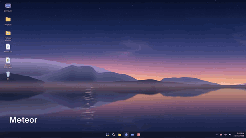

# Flick

Throw files from your Android phone onto your PC (Windows, Mac or Linux) with a flick, and send PC files back to the
phone. Send files from phone to phone and from PC to PC too. Share the clipboard and links, sync folders, see phone
notifications on the PC, use the phone as a media remote, and share files with an iPhone or any computer through a
browser. Devices talk directly (Wi-Fi, a USB cable, the phone's hotspot or Bluetooth), encrypted; nothing goes through
the internet.

## Install

1. On the PC, from the latest [release](https://github.com/Maniw1234/flick/releases/latest):
   - **Windows** 10 or 11, 64-bit: download `Flick-Setup.exe` and run it. Flick isn't code-signed, so Windows may show
     "Windows protected your PC" the first time: click **More info**, then **Run anyway** (once). Your browser may also
     warn that the file isn't commonly downloaded: keep it. It installs into Program Files; another folder
     (`Flick-Setup.exe /D=<folder>`, or winget's `--location`) is used only if no one but the administrators can change
     the folders it would be in (new ones get Program Files' permissions), never Flick's own data folder or a folder
     that holds other files.
   - **Mac** (macOS 13 or newer): `Flick-mac-arm64.dmg` for Apple silicon (M1 and newer), `Flick-mac-x64.dmg` for an
     Intel Mac. Open it and drag Flick to Applications. Or install it with [Homebrew](https://brew.sh):
     `brew install --cask maniw1234/flick/flick`. Flick isn't notarized by Apple (there's no paid Apple Developer
     account), so macOS refuses to open it the first time: open System Settings > Privacy & Security, scroll down to
     the message about Flick and click **Open Anyway** (once). When macOS asks whether Flick may find devices on the
     local network, allow it: Flick can't reach the phone without it.
   - **Linux** (64-bit): `Flick-linux-x86_64.AppImage`: make it executable (`chmod +x`) and run it. Or unpack
     `Flick-linux-x64.tar.gz` anywhere and run `Flick/flick`. Either way Flick adds itself to the applications menu.
2. On the phone (Android 9 or newer): open the same release page, download `Flick-<version>.apk` (or `Flick.apk`, the same file) and install it
   (Android asks you to allow installs from your browser once).
3. Open Flick on both, press and hold **Connect** on either one, check that both screens show the same code, then
   click (or tap) **Allow** on the other one and **Same code** on the one you held. On the same Wi-Fi, or with the
   phone on a USB cable to the PC (hold Connect on the phone then, and there's no Same code to tap); when the phone is
   on another Wi-Fi, the PC's Connect offers **Use this PC's Wi-Fi**, which makes a Wi-Fi network the phone joins
   with its camera (Windows, Linux).

Both update themselves after that. The first time each one opens, a short tour (six steps on the PC, seven on the
phone: Back, Next, Skip, or Esc) dims the screen and points at each real button: Connect, sending files, Transfers,
your devices, History, Settings and Advanced settings. **Show the tour again** in Settings > Help brings it back.

## Where things are

On the PC, Flick's window has a bar at the bottom: **Home**, **Devices**, **History** and **Settings** (Ctrl+1 to 4).
Home follows the connection: with nothing connected it shows Connect, and if Connect finds nothing it asks
**Can't find your phone?** with plain choices (use this PC's Wi-Fi, a USB cable, or the firewall fix for the same
Wi-Fi). Once connected, Home is a big area to drop files on, with Browse your phone, Share with a browser and Clipboard
history below it (each can be hidden; Settings > Help brings them back). Devices lists the paired phones and computers
and has **Connect a device**.

On the phone, the ••• menu starts with three tiles, **Other phones**, **History** and **Settings**, with the rest
listed below them.

## Settings

Settings shows what most people change: where received files go, the device's name, starting with the computer (the
PC), notifications and updates; on the PC, the paired phones (each can save files as they come or ask first) are under
Devices. Everything else (the animations, placement, keyboard shortcuts, Air grab, connections, transfer options and
the phone features) is on its own page, **Advanced settings**, at the bottom of Settings. Back (Esc on the PC) goes
from it to Settings.

## Mac and Linux

The PC app is the same everywhere, with these differences:

- **Sending PC files to the phone:** everywhere, drag files to the screen's edge on the phone's side, or select them
  and press Ctrl+Alt+F (Command-Option-F on a Mac; on Linux, where file managers don't say what's selected, copy them
  with Ctrl+C first). On Windows, File Explorer's right-click menu also has Send with Flick and Send to > Flick
  (phone). On a Mac, drop files on Flick in the menu bar or in the Dock, or right-click them in Finder and choose Open
  With > Flick. On Linux, choose Open With > Flick in the file manager.
- **Bluetooth** is Windows only.
- **The phone as a media remote:** on a Mac, macOS asks once to let Flick control the computer (Privacy & Security >
  Accessibility); on Linux it needs `playerctl` (for example `sudo apt install playerctl`). Flick on the PC says so
  when the phone's remote is used without it.
- **Linux:** under Wayland Flick runs through X11 (XWayland), since its animations cover the screen and stay on top,
  which Wayland doesn't let a window do. There, Ctrl+Alt+F only reaches Flick while its window is in front: to use the
  keys anywhere, add them as a custom shortcut in the system's keyboard settings that runs Flick with `--send-shortcut`
  (Flick's window shows the exact command). Received files go to Downloads. To remove Flick, delete the AppImage or the
  folder, and `~/.local/share/applications/flick.desktop` and `~/.config/autostart/flick.desktop`; its settings and
  pairings are in `~/.config/Flick` and the updates it downloaded in `~/.local/share/Flick`.

## Phone to phone, PC to PC

- **Phones:** open Flick on both phones and hold Connect on one (or tap ••• > Other phones and Pair next to the other
  phone). They find each other on the same Wi-Fi, nearby over Bluetooth (Android 10 or newer), or on one USB-C cable
  between them; big files between phones not on the same Wi-Fi switch to Wi-Fi Direct by themselves. Both show the
  same 6-digit code: tap Allow on the other phone and Same code on this one. From then on either one can send to
  the other: a file's menu has Send to <phone>; with files selected there's a phone button next to Send (on a phone
  never paired with a PC, Send itself); and Send on that page opens Android's pickers or lets you choose in Flick. Folders keep
  their folders. Files arrive in Download/Flick (or, when Flick can't see the phone's files, in the Flick list with a
  copy in Pictures, Movies, Music or Download). A phone takes files while Flick is open on it (or always, with Stay
  connected in the background on), and "Let other phones send to this phone" on that page turns it off.
- **Computers:** hold Connect in Flick's window, or open Devices on the bar: the other computers with Flick on the
  same network (or on a USB4, Thunderbolt or transfer cable) show up there. Click Pair, check that both show the same
  code, click Allow on the other one and Same code on this one. Then
  drop files or folders on a computer in the list, or use Send files / Send a folder. Your phones are in that list too.
- Remove (on either device) unpairs both. A device paired only one way (it can send to this one, but the pairing wasn't
  finished from here) is listed too, to pair from here as well or remove. A computer with Flick 2.0 or older is listed
  as needing an update: it can't take files from other computers.

## Animations

The animations are off on a new install: turn them on in Settings > Advanced settings (on the PC under Look and sound,
on the phone under Animations). With them off, files move just the same: a small card in the corner of the PC's screen shows what arrived and
how each transfer went (with that card turned off too and Flick's window closed, a notification says so), and every
hint still shows. An update from an older Flick keeps them as they were.

A file flies onto the PC with one of four animations, each timed to its own sound (the whole sound, sped up so its
peak is the moment the card lands): **Meteor** catches fire and crashes down, **Volt** jumps across on lightning,
**Warp** flies out of a tunnel of light and **Glitch** skips across like a broken signal. **Surprise me** picks one
for each file. Files sent to the phone leave the same way. Choose in Flick's window (Settings > Advanced settings >
Look and sound) or on the phone (Settings > Advanced settings > Animation). Flick's window also has the sound, its volume and **Reduce effects** (a lighter version, which Flick also
uses by itself on a PC that can't keep up). The phone gives a short thud as the card lands. The animations are worked
out from the time since the flick alone (`pc/overlay/looks/`) and drawn with WebGL (`pc/overlay/fx2.js`), with the
desktop under them bent and lit where Flick may take a picture of it (on a Mac, only if Screen Recording is allowed for
Flick; not under Wayland).

## Air grab

Pick files up with your hand and drop them on the PC, without touching the screen.

- **Phone to PC:** in the phone's Settings > Advanced settings, turn on **Air grab** (Android asks for the camera once). Hold your open
  hand over Flick: the file under it lights up. Pinch (thumb and index) to select it, and keep pinching across more
  files to select those too. Make a fist to grab: the file open full screen, else the selection, else the lit-up file.
  Move your fist toward the PC and open your hand in front of it: the file lands where your hand is (on a PC without a
  camera, or with the camera off in Flick's window, it comes in from the edge). Open your hand over the phone again to
  put the files back. A video that was playing carries on on the PC from the same second.
- **PC to phone:** with Flick open on the phone, select files on the PC (in File Explorer, on the desktop or in
  Finder), hold your open hand up in front of the screen and close it into a fist: the files are in your hand (their
  card follows it). Take the fist to the phone and open it over the phone: they go there. Opening your hand in front of
  the PC again puts them back. On Linux, file managers don't say what's selected: copy the files (Ctrl+C) instead of
  selecting them.
- **The cameras:** the phone's front camera runs only while Air grab is on, Flick is open on screen and a PC is
  connected. The PC's camera turns on only for a few seconds: after a grab on the phone, until the file lands, and after
  you select files on the PC (or bring a window with files selected to the front) while Flick is open on the phone; at
  most 30 seconds at a time and 45 seconds in any 2 minutes, of which selections no hand came up to grab get 20 at most
  (the rest is kept for grabs). macOS asks once for the camera, and once to let Flick ask Finder what's selected; turn
  the PC's camera off in Flick's window: Settings > Advanced settings > Files and shortcuts > Air grab: use this PC's
  camera. Hand tracking runs on each device, with MediaPipe's hand
  models on Flick's own WebAssembly engine (`hand/`); no picture leaves the device.
- **Aiming:** a hand moves a little as it closes or opens, so the file grabbed is the one the hand was over just before
  it began to close, and a file lands on the PC where the hand was just before it opened (`phone/hand/stream.js`:
  `aim`). The hand's position is smoothed with a One Euro filter (a still hand doesn't jitter, a quick one doesn't lag),
  and the light stays on a file until the hand is clearly over the next one.

## What's in here

| Folder | What it is |
|---|---|
| `pc/` | PC app (Electron, for Windows, macOS and Linux; `platform.js` holds what macOS and Linux do differently): LAN server (HTTP, WebSocket, UDP discovery, mDNS), the transparent overlay with the animations (`overlay/looks/`: Meteor, Volt, Warp, Glitch; `overlay/fx2.js` draws them; their sounds in `overlay/sounds/`), the settings panel, the service that hands phone updates to the phone, the phone features (`phoneapi.js`, `features.js`, `sync.js`, `clip.js`, `history.js`, `keys.js`, `browse.js`, `cliphist.js`, `ask.js`), files already received (`have.js`), Air grab (`air.js`, `air/`, `clipfiles.js`, `selwatch.js`), the send shortcut (`selnow.js`), the PC's own Wi-Fi network (`hotspot.js`), Send feedback (`feedback.js`), the "Share with a browser" page (`webshare.js`, `web/`) and Your other devices (`peerlink.js`, `panel/devices.js`) |
| `phone/` | The phone app's interface (HTML, CSS, JS) that runs inside the Android app's WebView, and the hand tracker it shares with the PC app (`phone/hand/`: models, engine, camera and gestures) |
| `hand/` | Air grab's hand tracker source: the WebAssembly engine (`engine.c`), the converter from MediaPipe's TensorFlow Lite models (`convert.py`), `build.sh` (fetches the models, checks them, builds `phone/hand/`) and tests |
| `android/` | Android app (Java, built without Gradle): WebView host, file browser access, transfers (the send engine that carries on in the background: `Outbox.java`, `Wire.java`, `Sends.java`), folder bundles, self-updater, the background parts of the features (link service, auto-send, tiles, widget, notification forwarding, folder sync, Browse phone, clipboard history, Send feedback), and phone to phone (`Peers.java`, `PeerServer.java`, `PeerClient.java`, `PeerCert.java`) |
| `native/` | Small helpers: on Windows (built with MinGW) `flick-bt.c` offers Flick's Bluetooth service, `flick-keys.c` presses media keys for the phone's remote and `flick-sparse.c` makes a file that arrives in parts sparse; `flick-keys-mac.swift` presses media keys on a Mac |
| `ci/` | The release workflow's phone-app step (`phone_app.sh`, which also builds the Google Play bundle) and the Google Play upload (`play_upload.js`) |
| `play/` | The Google Play listing: its text and the Play Console's answers (`listing.md`), the icon, feature graphic and screenshots, and `make_graphics.py`, which makes them |
| `installer/` | NSIS script for `Flick-Setup.exe`, and the Linux launcher (`flick-launcher.sh`) |
| `packaging/` | winget manifests and the Homebrew cask, the script that fills them in for a release, and `fuses.js`, with which the builds turn off Electron's ways of running other code as Flick |
| `signing/` | How the phone app and releases are signed, plus helper tools (no keys) |
| `art/` | Source art: the icons and tray icons as drawn (SVG) and in each size, the Android icon's layers, and the README's animation; the copies the apps use are in `pc/assets/`, `android/res/` and `play/` |

## Releasing a new version

1. Raise `"version"` in `pc/package.json` and add a `## <version>` section to `CHANGES.md`.
2. Push to `main`.
3. When the release is out, sign it on the computer that keeps the release key, in your checkout on the commit you
   pushed: `node signing/sign_release.js <version>` (`signing/README.md`: it also needs Java and uber-apk-signer.jar,
   and asks you to vouch for native helpers it hasn't seen). It signs only a release that is exactly what that commit
   builds. Installed copies don't take a release before that.
4. Then fill in the winget manifests and the Homebrew cask for it: `node packaging/update.js <version>`
   (`packaging/README.md`).

GitHub Actions (`.github/workflows/release.yml`) then builds the Windows app and its installer, the two Mac apps and
their disk images (on a Mac), and the Linux AppImage and tar.gz, and publishes one release with `Flick-Setup.exe`,
`Flick-mac-arm64.dmg`, `Flick-mac-x64.dmg`, `Flick-linux-x86_64.AppImage`, `Flick-linux-x64.tar.gz`, the update bundles
(`flick-app-<version>.zip` for Windows, `flick-app-mac-<version>.zip`, `flick-app-linux-<version>.zip`), the phone app
and `SHA256SUMS`, which lists every one of them.
If `android/`, `phone/` or `build_apk.sh` changed since the last release, it also builds the phone app as the new
version and signs it with the `FLICK_SIGNING_KEY` secret (`signing/README.md`); otherwise the last release's phone app
is reused, so phones aren't asked to update for nothing. A push without a new version number doesn't release anything.
To try the whole build without publishing: Actions > Release > Run workflow, tick "Only build and check" (the
builds can be downloaded from the run for five days).

## How updates reach your devices

- **PC:** Flick checks the latest GitHub release when it starts and every 30 minutes. Once the release's `SHA256SUMS`
  carries a valid `SHA256SUMS.sig` (Flick's release key), it downloads its system's update bundle
  (`flick-app-<version>.zip` on Windows, `flick-app-mac-<version>.zip`, `flick-app-linux-<version>.zip`), checks its
  SHA-256 against that signed list, unpacks it into a folder of the user's (`%LOCALAPPDATA%\Flick\app` on Windows,
  `~/Library/Application Support/Flick/app` on a Mac, `~/.local/share/Flick/app` on Linux), and restarts into it once
  no transfer is running (`pc/updater.js`, `pc/boot.js`). No installer and no admin prompt is involved. If a new
  version fails to start three times, Flick goes back to the installed copy and skips that version.
- **Phone:** the phone app checks the latest GitHub release when it opens (and every few hours while open) and
  downloads the new `Flick-<version>.apk` from it. On mobile data (or another network with a data limit) it doesn't
  download it by itself: the update card says it's waiting for Wi-Fi and offers Download with the size, and the next
  check on Wi-Fi fetches it. A paired PC also offers it over Wi-Fi, with its release's signed `SHA256SUMS`. Either
  way the phone checks that the signed `SHA256SUMS` lists that exact file, and its size, version and signing key, and
  shows **Install**. Android then asks for one more tap to confirm. The phone app needs Android 9 or newer (the PC
  doesn't offer it to older phones).

## Connections

- **Wi-Fi, USB cable, hotspot:** the phone finds the PC with a UDP broadcast on every network it is on (Wi-Fi, USB
  tethering, its own hotspot) and uses the fastest one: cable, then hotspot/direct, then Wi-Fi through a router.
  If a faster link appears while connected (a cable is plugged in), it moves over once nothing is being sent.
  It also asks over mDNS (`_flick._tcp`, answered by `pc/mdns.js`) and asks directly at every address each paired PC
  was seen at (the PC lists its addresses when a phone connects), so a PC is found again on networks that drop
  broadcasts or put it in another subnet.
- **Bluetooth** (Windows): for when there's no network. The PC runs `bin/flick-bt.exe` (an RFCOMM service with
  Flick's UUID) when Bluetooth is on in its settings; the phone connects to a paired PC and runs the normal
  HTTP/WebSocket traffic over it through a small multiplexer (`pc/mux.js`, `android/.../BtMux.java`). Much slower than
  Wi-Fi.
- **Quick Share:** `pc/quickshare.js` makes the PC a Quick Share receiver on the local network (mDNS advertisement,
  UKEY2 key exchange, encrypted Nearby frames). The PC asks before accepting and shows the same code as the phone.
- **Large files** go over several connections at once (`/api/part` up, HTTP byte ranges down), and **batches**
  (several files or folders) are split across several `/api/bundle` streams (`streams=k&stream=i`) that write into one
  staging folder on the PC. Once every part of a large file is in, the phone sends the file's SHA-256
  (`commit=1&sha256=…`) and the PC reads back the file it assembled: only a match counts as received; a mismatch is
  refused (422) and the phone sends the file again. Files are put together in a folder of the user's own, closed to
  others (Windows and macOS: the user's temp folder, `flick-incoming`; Linux: `~/.cache/flick/incoming`, on disk
  rather than a shared, often in-memory /tmp), or, when the save folder is on another drive, in a hidden
  `.flick-incoming` inside it, so that saving is a rename; one that can't be put in place is moved to Flick's own
  "Not saved" folder (on Windows under `%LOCALAPPDATA%\Flick`; one staged on the save folder's drive stays on that
  drive, in `.flick-incoming/Not saved`) and the user is told, never deleted.
- **Sends that carry on** (protocol 7): the phone's sends are jobs in the app (`Outbox`, `Sends`; written down in
  `files/outbox`), sent straight over pinned TLS (`Wire`) and kept going by a foreground service, with `ResumeJob`
  (JobScheduler) bringing the app back if Android stopped it. With `resume=1` the PC keeps what arrived of each part
  or bundle stream for 6 hours while Flick runs there (what's still arriving when it quits is deleted then, and what
  a crash left goes soon after the next start), `GET /api/status` says how far each got, and the phone sends the rest
  (`from=` bytes into a part; `skip=`/`from=` for a bundle stream, whose entries are numbered). The PC hashes each
  part as it arrives, so the check at the end (`commit=1&sums=…`, one SHA-256 per part) only reads back parts that
  came out of order. Also `/api/speed` (Settings > Speed test), `/api/have` (files the PC already has, by name, size
  and a fingerprint of their first and last 256 KB; `pc/have.js`, `Have.java`) and `/api/cancel`. A send canceled or
  turned down on the PC is answered 410 from then on (with `why=declined|timeout` when the PC's user turned it down
  under "Ask each time"); Try again on the phone starts a new attempt with `again=1`, which the PC takes.
- **Kept connections:** `Wire` keeps up to 8 idle TLS connections per PC for 8 seconds, so a send's checks, parts and
  streams don't each pay for a new handshake; a request on a kept connection that hears nothing within 4 seconds goes
  again on a new one. The PC answers `Connection: close` when it answers an upload before its body has arrived (no
  space, say). A fresh attempt skips `/api/status` (nothing can be on the PC yet), and `/api/have` also checks the
  PC's free space (`bytes=`, 507 when it won't fit). On Windows, a file that arrives in several parts at once is made
  sparse first (`bin/flick-sparse.exe`, `FSCTL_SET_SPARSE`), so NTFS doesn't fill it with zeros ahead of each part.
- **The PC's own Wi-Fi** (`pc/hotspot.js`), for Share with a browser from another network: the Windows Mobile hotspot
  (PowerShell, WinRT tethering) or, without an internet connection to share, a Wi-Fi Direct network Flick keeps up;
  NetworkManager's hotspot on Linux. The panel shows a Wi-Fi QR code (`WIFI:T:WPA;S:…;P:…;;`) and the page's.
- **Background link:** with "Stay connected in the background" on, the phone's `LinkService` keeps
  `GET /api/events` open (one JSON event per line: clipboard, links, ringing, Browse phone), so the features work
  while Flick is closed; tiles, the widget, auto-send and notification forwarding post to the same encrypted link
  (`PcClient`).
- **Several phones:** up to four stay connected; PC-initiated sends go to the phone in use, chosen in the
  panel or by using a phone, and replies about a transfer go to the phone that started it.
- **Browsers** (Share with a browser): `http://<PC address>:47860/w/<token>/`, from the QR code in the panel. Plain
  HTTP on the same port, with its own routes and checks (`pc/webshare.js`).
- **Other devices** (PC to PC, phone to phone): a device looks for others of its kind with the same UDP broadcast,
  marked `peer:1` and `kind` (`pc` or `phone`), so a phone looking for its PC never sees another phone and a PC never
  lists phones this way. The sender (`pc/peerlink.js` on a PC; `PeerClient.java` on a phone) opens TLS to the other
  device's receiver (the PC's server on 47860; `PeerServer.java` on a phone, on 47860 and UDP 47870 while Flick is
  open, or all the time with Stay connected in the background on), signs in on `/ws` with `peer:1` the way a phone
  signs in to a PC, announces what's coming (`send`) and uploads it with `/api/upload` (one file) or `/api/bundle`
  (several, or folders); `got` (all of it is there: the upload's own answer can be lost when its connection breaks
  right then), then `saved` / `failed`, come back on the WebSocket.
  Pairing: the requester commits to its half of the code (`connect` with a hash of it), the receiver commits
  to its own (`pairing`), the requester reveals its half (`pair-reveal`), the receiver shows the request to its user and
  only then reveals its half (`pair-nonce`); `paired` brings the token once that user allows it. The requester's user
  confirms the code too (`pair-done`): until then the pairing allowed on the receiver is only on the way, and goes if
  the link closes first. Pairing goes both ways at once: right after it the sender hands the other device a token and
  the certificate of its own receiver (`peer-back`, taken only on that link, right after), and Remove tells the other one
  (`peer-forget`). A phone puts what
  arrives together in a hidden folder next to where it goes (`Download/Flick/.peer-<id>.flickpart`, or Flick's own
  files), so putting it in place is a rename (`Peers.java`).
- **Connect** (2.1): holding Connect looks for every kind of Flick device at once (discovery answers say `ready` while
  that device's Connect screen or window shows) and asks the one meant with the pairing above. A PC asking a phone
  (`connect` with `home:1`) gives it this PC's own phone pairing (`home`: token, certificate, addresses) only after its
  user clicked Same code; a phone asking a PC says `confirm:1`, and the PC keeps that pairing only once the phone sends
  `pair-done` or signs in with it. Over a USB cable, the other side's Allow is enough.
- **Phones without a shared network** (2.1): `Tunnel.java` carries many TLS connections over one byte stream (frames
  `FLKTUN1`), over a Bluetooth LE L2CAP channel (`BleLink.java`) or a USB-C cable between two phones, one of them in
  Android Open Accessory mode (`UsbPeer.java`); the phone's `PeerClient` and `PeerServer` run over it as over Wi-Fi.
  Phones advertise a hash of the quarter hour keyed with their own Bluetooth key, which only their paired phones have
  (sent over the signed-in, pinned link), and a phone not on screen says who it is only to those. Files over 3 MB
  switch to Wi-Fi Direct (`WifiDirect.java`): the receiver makes a group and sends its name and password over the
  paired link; the sender joins it for that send.

## Security

- **Encrypted links.** Everything between phone and PC travels over TLS on the PC's port 47860 (the same port also
  answers plain HTTP, for the browser page). Each PC makes its own certificate once
  (`tls-cert.pem` in its settings folder); a phone pins its SHA-256 when it pairs and from then on connects to no
  other. The phone app reaches the PC through a local port inside the phone (`TlsProxy`); its network security config
  allows unencrypted connections only to the phone itself. Bluetooth links are encrypted by Bluetooth.
- **Pairing.** The PC asks before a new phone can connect, and both screens show the same 6-digit code: the phone
  commits to its half of the code before the PC sends its half, so nobody in between can make the codes match. The
  user clicks Allow on the PC and taps Same code on the phone: the PC gives the phone a random token only after Allow,
  and the phone keeps it (and pins the certificate) only after Same code, so a stranger answering in the PC's place
  gets nowhere either.
- **Signing in** never sends the token: on every connection the PC proves it holds the phone's token
  (an HMAC over both sides' random numbers and the certificate the phone sees), then the phone proves the same. A
  relay in the middle (with its own certificate) can neither read nor pass on these proofs. A pairing made without the
  code (its token crossed the network in the clear) signs nothing in: that phone is asked to pair again with the code.
- **Requests.** Every upload, download and update fetch carries the token, and once a phone has signed in securely, its
  token works only over an encrypted link (a pairing made without the code is good for plain file transfers only, until
  that phone pairs again). The phone only accepts files, status and updates from the PC it signed in
  to. Pairing prompts are rate-limited, and browsers can't reach the phone API (a web `Origin` or a DNS-name `Host`
  gets 403).
- **Received files** are marked as downloaded from the internet (`Zone.Identifier`), so Windows SmartScreen and
  Office Protected View apply; on a Mac they get the quarantine mark, so Gatekeeper checks an app or script before it
  first opens. "Open files when they arrive" never launches programs, scripts or shortcuts.
- **Limits.** WebSocket messages, pre-accept Quick Share data, open connections (64 per address, 512 in all) and
  Bluetooth stream buffers are capped; request headers must arrive within 20 seconds; WebSocket frames that break the
  protocol (unmasked, reserved bits, unknown opcodes) close the connection; uploads and Quick Shares that won't fit on
  the disk are refused up front.
- **Bluetooth** accepts only paired devices over an encrypted link.
- **Other devices** (PC to PC, phone to phone) pair with the same code and checks as a phone and a PC, both ways: each
  device keeps the other's certificate (a phone makes its own, `PeerCert.java`, kept in Flick's private files) and a
  token of its own for sending there, and signs in with the same proofs (signing in never sends the token). Every
  upload carries the token, inside the encrypted, pinned link only. Each side commits to its half of the pairing code
  before either says it, and a receiver says its half only once the request is on its user's screen: nobody can steer
  the code, or try code after code unseen. A pairing allowed on one device counts only once the other device's user has
  confirmed the code too. Another computer or phone signed in this way can only send files: it never becomes the phone
  in use and reaches none of the phone features. A phone answers other phones only while Flick is open on it, or while
  Stay connected in the background is on (then only the devices it's paired with find it over the network or Bluetooth),
  and only with "Let other phones send to this phone" on; it shows Allow / Don't allow for each pairing (one request
  at a time, rate-limited per address and in all, a pause after Don't allow, and it says when the device is paired
  already), takes at most 120 announcements a minute from one device, shows a card's picture only when it's a small
  one, reads only plain JSON from the network, rebuilds every received path segment by segment (nothing lands outside
  where files go) and refuses what won't fit, or what goes past what was announced.
- **Phone features.** Clipboard, links, notifications, folder sync, the background link and the remote work only for a
  phone paired with the code, over an encrypted link: a token from a pairing made without it reaches none of them. Links
  open only `http`/`https` addresses. Synced folders stay inside `<save folder>/Flick Sync/`, one per phone, and refuse
  `..`, absolute paths, Windows reserved names, `:` streams, links and direction marks; nothing is ever deleted.
  Notification forwarding is off until the user turns it on and grants access; clipboards that a password manager marks
  as private are never sent, and a clipboard is never sent back to where it came from.
- **Browse phone** is off until "Let your PC browse this phone" is turned on in the phone's Settings. The PC can then
  only list and copy files in shared storage (never hidden files, `Android/data` or `Android/obb`), never change or
  delete one; the phone answers only the PC it paired with (`PcClient`), and both sides rate-limit the requests. The PC
  takes only answers to requests it made; a "copy" it didn't ask for is treated like any other file from that phone.
- **Ask each time** (per phone, on the PC) saves nothing from that phone before the user clicks Accept; Decline, or no
  answer within a minute, deletes what arrived. **Clipboard histories** (the last 20 on each side) stay on that device
  and never keep a clipboard marked as private.
- **Send feedback** posts to a Google Form only when the user presses Send, with what the form showed: the message,
  the email if given, and the device info and the last crash report only when ticked. Without a connection it waits on
  the device until it can be sent.
- **Lock Flick** (phone Settings, off until turned on, and only on a phone with a screen lock): Flick asks for the
  phone's fingerprint, face or PIN when it opens and when it comes back after more than 30 seconds away, and covers its
  screen until then (Recents shows no picture of it either). Only the screen is locked: transfers and the background
  features keep running, and the Quick Settings tiles and the widget keep working, since they only send the last photo
  or the clipboard and show no files (`AppLock.java`).
- **Share with a browser.** Browsers can't pin Flick's certificate, so this part is plain HTTP: anyone on the network
  could read what an allowed browser sends or downloads. The link carries a random token; the PC asks before each
  browser joins and both screens show a 4-digit code; a browser's session works only from the address that was allowed;
  sharing ends when stopped or after 30 minutes without activity. Its pages can't reach the phone API.
- **Updates.** Every release's `SHA256SUMS` is signed with an offline release key that GitHub never sees, and the PC
  and the phone install nothing that signed list doesn't vouch for. The key signs only after `signing/sign_release.js`
  has checked the release against the commit as it is on the computer that keeps the key: the release's tag is that
  commit; in each of the three update bundles (what installed PCs update themselves with) every file taken from the
  source (JavaScript, HTML, CSS, pictures, the hand tracker) is that commit's, byte for byte, and the build adds only
  the Electron version to `package.json`; the native helpers in the Windows and Mac bundles (`bin/`, which GitHub
  compiles from `native/`) are ones the key's owner has vouched for (`signing/helpers.sha256`); the phone app's page is
  the commit's `phone/`, byte for byte, the phone app is signed with Flick's own key and nothing else, and it is built
  for that release or is an earlier signed release's, unchanged since. What that can't vouch for is trusted as GitHub
  builds it: the installers and disk images (`Flick-Setup.exe`, the `.dmg` files, the AppImage and the `tar.gz`, which
  new installs, winget and Homebrew use), and the phone app's compiled code and resources, which GitHub builds and signs
  with Flick's phone-app key (a GitHub secret; Android checks that key, on Android 9 and newer). CI pins every
  tool the workflow downloads itself by checksum (Electron, rcedit, uber-apk-signer, bundletool, appimagetool and the
  AppImage runtime) and every action it uses by commit; the rest is what GitHub's runner images and Ubuntu's packages
  provide (Java, Node, the Android SDK, NSIS, Wine, the MinGW compiler, Xcode's tools).
- **Flick's program.** The builds turn off three Electron switches Flick never uses (`packaging/fuses.js`):
  `ELECTRON_RUN_AS_NODE`, `NODE_OPTIONS` and `--inspect`, and Flick drops Chromium's `--remote-debugging-port` and
  `--remote-debugging-pipe` as it starts (`pc/boot.js`). So another program on the computer can't start Flick's program
  with one of these to run its own code in it, under Flick's name (with Flick's firewall rule on Windows, or the
  permissions given to Flick on a Mac). That isn't everything another program running as you could try: on a Mac, for
  one, Flick isn't signed with Apple's hardened runtime, which would also refuse libraries put into it. The program
  comes only with the installer (or disk image, AppImage, tar.gz): a PC that updated itself from 2.0.0 keeps 2.0.0's
  program, without any of this, until a 2.1 or later installer is run on it.

## Building by hand

The builds run on Linux, except the Mac disk images, which need a Mac.

- `./build_apk.sh <versionCode> <versionName>` builds the phone app (javac, d8 or dx, aapt2, and `FlickSign.java` with
  uber-apk-signer's apksig). The version code is `100000 + major*10000 + minor*100 + patch` (110000 for 1.0.0). It
  uses the Android SDK in `$ANDROID_HOME` (platform 36, build-tools 36.0.0), `uber-apk-signer.jar` in `$FLICK_TOOLS`
  (default `~/flick-tools`) and the private signing key in `$FLICK_KEYS` (default `~/flick-keys`, see
  `signing/README.md`). `pc/phone-app/Flick.apk` isn't committed: build it, or take it from the latest release, before
  building the PC app.
- `FLICK_VARIANT=play ./build_apk.sh <versionCode> <versionName>` builds the Google Play version instead: the same
  code as `io.github.maniw1234.flick`, without the permission to install apps. It makes `build/Flick-play.aab` (the
  app bundle Play takes: also needs `bundletool-all-1.18.3.jar` in `$FLICK_TOOLS`, or `$BUNDLETOOL`, and the JDK's
  `jarsigner`, which signs it with Flick's key as the upload key: Play signs what it hands out with its own) and `build/Flick-play.apk` to try on a phone.
  It leaves `pc/phone-app/Flick.apk` alone. `play/listing.md` says how the first one gets to Google Play.
- `./build_win.sh` builds `build/win/Flick-Setup.exe` and the update bundle (Electron for Windows and rcedit from
  `$FLICK_TOOLS`, Wine with `xvfb-run` for rcedit, NSIS, and a MinGW C compiler for the Bluetooth, media-key and
  sparse-file helpers). Without rcedit working, `Flick.exe` keeps Electron's icon and name; `STRICT=1` stops the build
  then instead.
- `./build_mac.sh` builds `build/mac/Flick-mac-arm64.dmg`, `Flick-mac-x64.dmg` and the update bundle on a Mac
  (Electron's macOS zips from `$FLICK_TOOLS`, and Xcode's command line tools: `swiftc` for the media-key helper,
  `codesign`, `hdiutil`). Elsewhere it stops at the two `Flick.app` folders, unsigned and without the helper.
- `./build_linux.sh` builds `build/linux/Flick-linux-x86_64.AppImage`, `Flick-linux-x64.tar.gz` and the update bundle
  (Electron for Linux, appimagetool and the AppImage runtime from `$FLICK_TOOLS`).

Each tool path can also be set with its own environment variable; the workflow shows how. Electron is the same
version for every system (`electronVersion` in `pc/package.json`, with the checksum of each download next to it): each
build script checks the Electron zip it is given against them and stops on any other.

## Versions

See `CHANGES.md`.

## Privacy

See [`PRIVACY.md`](PRIVACY.md); the phone app shows the same text in Settings > Help > Privacy.

## License

MIT. See `LICENSE`.

Air grab's hand models (`phone/hand/palm.fhm`, `phone/hand/landmark.fhm`) are MediaPipe's, used under the Apache License 2.0. See `phone/hand/LICENSE-MediaPipe.txt`.
